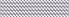
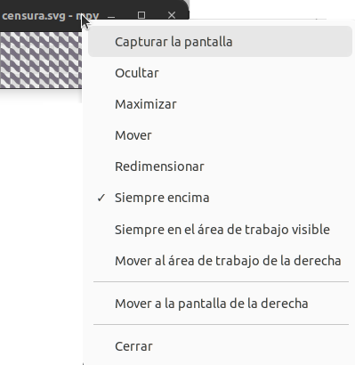

Se crea una imagen con Inkscape que, en mi caso, he guardado como censura:



Se instala mpv:

```shell
sudo apt install mpv
```

Se ejecuta el SVG:

```sh
mpv --no-osc --no-osd-bar --ontop --image-display-duration=inf censura.svg
```

Explicación de los parámetros:

* ```--no-osc```: Desactiva la barra inferior de controles de reproducción.
* ```--no-osd-bar```: Oculta cualquier texto o indicador en pantalla.
* ```--ontop```: Fuerza a la ventana a estar siempre encima de todo automáticamente.
* ```--image-display-duration=inf```: Evita que el archivo se cierre solo, manteniéndolo abierto infinitamente como una imagen estática.

Si se hace clic derecho sobre la barra de título de la ventana aparece una ventana con diferentes opciones:



La ventana flotante se mueve y redimensiona con el ratón.
